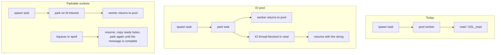

# Kotlin async HTTP for cpp-v2

## Goal

`readHTTP` stays the blocking header read it is today, on the main thread, on `__thread`, and inside a task. A new `asyncReadHTTP` method returns the same header string and, inside a task, waits without occupying a `TaskScheduler` worker. That wait is the coroutine shape behind Ktor and `withContext(Dispatchers.IO)`: the task waits, the carrier does not sit inside `read`.

This plan starts from the M:N scheduler already in the tree (`delay` / `join` / `await` park; `sleep` and `__thread` block). See [kotlin_threading_model_c7639cb6.plan.md](kotlin_threading_model_c7639cb6.plan.md). That work deliberately does not park sockets. This document is the follow-up, and it adds a new method instead of changing `readHTTP`.

Success, once D1 is chosen:

- Many concurrent `asyncReadHTTP` calls, each waiting on a peer that is slow to send headers, finish in about one wait plus scheduling, on both `./main` and `./main -vm`.
- While those calls wait, `TaskScheduler` workers are not blocked in `read`.
- `readHTTP` is unchanged, including inside a task. Servers that call it do not change.
- `asyncReadHTTP` returns the same header string `readHTTP` returns for those bytes.

## What the runtime does today

There are no socket opcodes. `__iosocket` builds an `Ad_Socket_Object` (`listenfd`, `connfd`, 1024-byte `sendBuff` / `recvBuff`). Evaluator and VM both dispatch methods to [`socket_utils.cpp`](../socket_utils.cpp):

| Ad method | C++ | Blocks in | Completes when |
|---|---|---|---|
| `create_server` | `create_server` | `bind` / `listen` | listening socket exists |
| `create_client` | `create_client2` | `getaddrinfo`, `connect` | TCP connected. `create_client` (hardcoded `127.0.0.1`) is unused |
| `accept` | `accept_socket` | `accept` | a client fd exists. The new object is not added to a GC in C++; the caller adds it |
| `send` | `send_socket` | `write` of one 1024-byte buffer | one `write` returns |
| `read` | `read_socket` | `read` loop | a short read, not necessarily EOF |
| `readHTTP` | `readHTTP` | `read` loop. This function stays as it is | headers contain `\r\n\r\n`, then `\r\n` is rewritten to `\n`. The body is whatever happened to arrive with the headers |
| `asyncReadHTTP` | new, not implemented | the wait chosen in D1 | the same string `readHTTP` would have returned |
| `sendAndReadBackHTTP` | `sendAndReadBackHTTP` | `write`, then `read` until `n <= 0` | peer closes (typical `Connection: close`) |
| `sendAndReadBackHTTPS` | `sendAndReadBackHTTPS` | `SSL_connect`, `SSL_write`, `SSL_read` until `<= 0` | TLS response consumed; the function also closes the fd |
| `close` | `close_socket` | `close` on `connfd` only | `listenfd` is not closed |

User-facing wrappers:

- [`bootstrap/sock.ad`](../bootstrap/sock.ad) — `ClientSocket.sendAndReadBackHTTP` / `HTTPS`, `ServerSocket.accept`, `MultiThreadedEchoServer` (`accept` on the caller, `readHTTP` + `send` on a `__thread`).
- [`bootstrap/requests.ad`](../bootstrap/requests.ad) — `get3` / `post` build a request string and call `sendRequest`, which is `sendAndReadBackHTTP` or `sendAndReadBackHTTPS`.

[`task_scheduler.h`](../task_scheduler.h) `AdSuspendRequest::Kind` is only `Delay` and `Join`. The worker loop parks those two and nothing else. A `spawn` that calls `sendAndReadBackHTTP` today pins a pool worker for the whole wait.

## Two mechanisms

Both free the `TaskScheduler` worker. They differ in whether an OS thread is blocked while the server is silent.

**IO pool (Kotlin `Dispatchers.IO`).** Inside a task, `asyncReadHTTP` throws a suspend, an IO thread runs the same header read `readHTTP` runs, and the scheduler resumes the task with that string. The fd stays blocking, so a later `readHTTP` on it is unchanged. `getaddrinfo` and OpenSSL stay as they are. Cost: one OS thread per in-flight call for the whole wait. Right for tens or hundreds of concurrent reads. Wrong for the same scale as `100k delay`, because the threads, not the fds, are the limit.

**Parkable sockets (Kotlin suspend I/O, Ktor).** For `asyncReadHTTP` only, the wait uses a non-blocking fd. A single reactor thread waits in `kqueue` (this host is Darwin) or `epoll`. The task parks on `EAGAIN`, as `delay` does, and is resumed when the fd is readable. No thread is blocked while the peer is silent. The call still finishes on `readHTTP`'s rule: the accumulated bytes contain `\r\n\r\n`, then `\r\n` is rewritten to `\n`. One readable event is not a finished header block. When `asyncReadHTTP` completes or is cancelled it clears `O_NONBLOCK`, so `readHTTP` on that socket still blocks in `read`. Cost: a state machine for this one method. TLS does not fall out of the blocking `SSL_read` loop.

An IO pool is not “skip parking.” If the pool worker waited on the IO thread with `future.get()`, the carrier would still be pinned. The task has to park, and the IO thread’s completion has to enqueue it, the same way the timer thread wakes a `delay`.

## Open decisions

D2 and D7 are decided. The rest are unresolved. Do not start the scheduler or socket work until the ones that change the design are closed. A lean is recorded so the next session can see the bias; a lean is not a decision.

### D1 — Which model ships

- **A. IO pool only.** Blocking `socket_utils` functions move onto IO threads when `ad_tls_task_ctx()` is set. No non-blocking fds.
- **B. Parkable sockets only.** Reactor plus non-blocking `connect` / `read` / `write` / `accept`. No extra pool.
- **C. Staged.** IO pool first for client HTTP including HTTPS and DNS. Parkable TCP next, for the “no thread blocked while the server is silent” case. HTTPS stays on the IO pool until a TLS state machine exists.

Lean: **C**. The client-HTTP goal is met by A, but only B or the second stage of C matches a wait that scales with fds rather than threads. B alone leaves HTTPS and `getaddrinfo` unsolved.

Status: **open**.

### D2 — `readHTTP` stays; `asyncReadHTTP` is new

Status: **decided** for the header read. The other socket methods are still open, below.

`readHTTP` does not change. Same C++ function, same blocking `read` loop, same header boundary, same `\r\n` → `\n` rewrite, same partial body. It blocks on the main thread, on a `__thread`, and inside a `spawn` task. `MultiThreadedEchoServer.process` keeps calling `client.readHTTP()`. Do not edit that call site to the async method.

`asyncReadHTTP` is a new runtime method on `OBJ_SOCKET`:

- Dispatch it beside `readHTTP` in [`evaluator.cpp`](../evaluator.cpp) and in `call_runtime_bound_method` in [`vm/vm.cpp`](../vm/vm.cpp). Add `asyncReadHTTP` in [`socket_utils.h`](../socket_utils.h) / [`socket_utils.cpp`](../socket_utils.cpp). No new opcode.
- The finished value is the string `readHTTP` would have produced for the same bytes. It does not grow a `Content-Length` body reader.
- Inside a task it parks, by the mechanism D1 chooses. It does not call the blocking `readHTTP` function on the carrier.
- Leave the `readHTTP` function body untouched. Do not refactor it into a helper shared with the async path.
- Clearing the fd back to blocking mode is part of finishing or cancelling `asyncReadHTTP` when the parkable path set `O_NONBLOCK`. An IO-pool implementation never sets `O_NONBLOCK`; its IO thread runs a private copy of the header loop so `readHTTP` cannot observe a flag change.

Off-task `asyncReadHTTP` (main, REPL, `__thread`) is not decided:

- **A.** Block on that thread, the way `delay` sleeps off-task, and return the same string.
- **B.** Return an error. The method is only valid inside a task.

Lean: **A**.

Status of this sub-choice: **open**.

### D2b — Other socket methods

`accept`, `send`, `read`, `create_client`, `sendAndReadBackHTTP`, and `sendAndReadBackHTTPS` are not covered by the `asyncReadHTTP` decision.

- **A. Leave them blocking** until a later plan adds `asyncAccept`, `asyncSend`, `asyncRead`, `asyncSendAndReadBackHTTP`, `asyncSendAndReadBackHTTPS`. This plan only adds `asyncReadHTTP`.
- **B. Add those `async*` names in the same project,** each parking inside a task, each leaving the current method untouched.
- **C. Make the current client methods park inside a task.** Rejected for `readHTTP`. Still available for the outbound call only.

Lean: **A**. `asyncReadHTTP` is the method this plan adds. Outbound `sendAndReadBackHTTP` stays a blocking pin until its own `async*` method is specified.

Status: **open**.

### D3 — Client only, or server too

`asyncReadHTTP` is the inbound header read. It is in this plan either way. Outbound `sendAndReadBackHTTP` is a different method and stays blocking while D2b is A.

- **A. `asyncReadHTTP` only.** No new accept or client-call method. A task that already has a connected socket can read headers without pinning a worker. `accept` and the HTTP client calls stay blocking.
- **B. Also add further `async*` methods** for `accept` and the client round trip. That is D2b option B, not a silent change to `readHTTP`.

Existing `test300` / `sock.ad` servers keep `readHTTP` on `__thread`. A new example may `spawn` and call `asyncReadHTTP`. Do not switch `MultiThreadedEchoServer` over.

Lean: **A**.

Status: **open**.

### D4 — HTTPS in the first slice

`sendAndReadBackHTTPS` is a blocking OpenSSL handshake and `SSL_read` loop, and it closes the fd before returning. `requests.ad` uses it for any `https://` URL.

- **A. HTTPS only via the IO pool,** even if plain HTTP is parkable. `SSL_connect` / `SSL_read` keep blocking, on an IO thread, after the task has parked.
- **B. Non-blocking TLS in the first slice.** `SSL_set_fd` on a non-blocking socket, `SSL_ERROR_WANT_READ` / `WANT_WRITE` mapped to the same park as a raw `EAGAIN`, `SSL*` and `SSL_CTX*` stored on the socket across resumes.
- **C. Drop HTTPS from this project.** `https://` keeps today’s blocking call and pins the carrier.

Lean: **A**. B is a separate state machine and should not gate plain HTTP. C leaves `get3` of an `https://` URL as a pool-pin.

Status: **open**.

### D5 — DNS

`create_client2` calls blocking `getaddrinfo` before `connect`. A parkable `connect` does not make name lookup non-blocking.

- **A. Resolve on the IO pool,** then non-blocking `connect` if the data path is parkable.
- **B. Blocking `getaddrinfo` on the carrier** before the parkable connect. Simple, and it pins a worker for DNS only.
- **C. A dedicated resolver** (`c-ares` or a small resolver thread). New dependency or new thread, only worth it if many lookups run together.

Lean: **A**. It reuses the pool D4 already wants for TLS.

Status: **open**.

### D6 — Reactor implementation, if D1 is B or C

- **A. Raw `kqueue` on Darwin and `epoll` on Linux,** one reactor thread owned by `TaskScheduler`. Workers do not call `kevent` / `epoll_wait`. They push register / deregister commands through a wakeup fd (`EVFILT_USER` on Darwin, `eventfd` on Linux) so the reactor is the only thread in the wait.
- **B. One portable library** (`libuv`, Asio, or similar).

Lean: **A**. The scheduler already owns a timer thread and a park/resume path; a second wait thread matches that. A library wraps the same idea and adds a dependency this tree does not have.

The reactor stays separate from the delay timer. `kevent` and the timer heap do not share a wait.

Status: **open**, and irrelevant if D1 is A.

### D7 — What `asyncReadHTTP` returns

Decided with D2. `asyncReadHTTP` matches `readHTTP` and does not widen it:

- Stop once the accumulated bytes contain `\r\n\r\n`.
- Rewrite `\r\n` to `\n` on the returned string.
- Leave the body as whatever arrived in the same reads as the headers. No `Content-Length` loop.
- On the parkable path, bytes already read live in a `std::string` on the suspend state, not only in `recvBuff`. A resume appends. It does not restart the message, and it does not write that partial buffer through `readHTTP`.

`send`, `read`, and `sendAndReadBackHTTP` keep their current completion rules because those functions stay blocking while D2b is A.

Status: **decided**.

### D8 — Errors and cancellation

Today a failed `connect` or `write` prints `perror` and often still returns a string or `nullptr`. `sendAndReadBackHTTPS` returns `nullptr` on handshake failure.

- **A. Resume an `Ad_Error_Object`** for connect, DNS, reset, and TLS failure when the call was parked. Blocking main / `__thread` paths may keep `perror` until a shared cleanup.
- **B. Keep perror-and-empty-string** on both paths.

`task_cancel` of a task parked in `asyncReadHTTP` must drop the fd interest or abandon the IO-pool job and fail the task with the same `"task cancelled"` failure `delay` uses. If the parkable path set `O_NONBLOCK`, cancel clears it before the task fails, so a later `readHTTP` on that socket still blocks. `close` on a socket that has a parked `asyncReadHTTP` fails that waiter and deregisters the fd. Cancelling an IO-pool thread blocked in `read` cannot reliably interrupt the syscall; the pool thread runs to completion and its result is discarded if the task already failed. `readHTTP` itself grows no cancel path.

Lean: **A** for the parked path.

Status: **open**.

### D9 — Where the accumulated buffer and the SSL handle live

The per-task GC must keep the `Ad_Socket_Object` alive across the park (it is already a parent or task heap object reachable from the continuation). The partial response is not an `Ad_Object` until the call completes.

- Store the partial `std::string`, non-blocking flag, and any `SSL*` on `Ad_Socket_Object` (or a side struct the socket points at), freed in the socket destructor.
- The finished `Ad_String_Object` is allocated on the task GC at resume time, then `copy()`’d into the joiner, same as any other task result.
- Do not put a resumed string only on the reactor thread’s stack.

Status: **lean fixed**. Open if the socket object is the wrong owner because `copy()` of `Ad_Socket_Object` is still a stub.

### D10 — IO pool size and blocking fallback

If an IO pool exists:

- Size is a fixed multiple of hardware concurrency, or an env override such as `ADLANG_IO_THREADS`. Unbounded thread-per-call recreates the overflow-pthread problem the scheduler just removed.
- Calls made off a task (main, REPL, `__thread`) do **not** hop to the IO pool. They block the thread they are on, as `delay` blocks off-task.
- A parked task that calls a socket method the chosen model cannot park (HTTPS under D4=A, or `getaddrinfo` under D5=A) submits one job to this pool and parks until that job finishes. It does not block the carrier.

Lean: fixed-size pool, off-task calls stay inline.

Status: **open** for the size and the env name. Irrelevant if D1 is B and D4 is B (no pool at all).

## Shared design, either model

### Suspend kind

Add `AdSuspendRequest::Kind::Io` next to `Delay` and `Join`.

- IO pool: the request carries the job (which function, which socket, which args) and no fd interest. `parkOnIo` stores the task, the IO thread runs the job, then enqueues the task with `pending_resume` set to the string or the error.
- Parkable sockets: the request carries the fd, the interest (`Read`, `Write`, `Accept`), and a continuation that already closed over the partial buffer. The reactor, on readiness, enqueues the task. The resumed slice performs one non-blocking attempt and either completes, parks again, or fails.

The worker loop in [`task_scheduler.cpp`](../task_scheduler.cpp) gains a third branch beside `parkOnDelay` and `parkOnJoin`. Evaluator and VM already catch `AdSuspendRequest` and snapshot the continuation; they do not need a new opcode. Socket methods stay runtime methods on `OBJ_SOCKET`.

`armResumeSlice` is the resume path for both. The reactor and the IO pool must not call Ad code themselves. They only enqueue.

### `asyncReadHTTP` wiring

`readHTTP` in `socket_utils.cpp` stays the blocking implementation. `asyncReadHTTP` is a separate function.

- Evaluator: a new branch next to `member_ident->value == "readHTTP"`. The `readHTTP` branch still calls `readHTTP` and registers the string with the GC.
- VM: a new branch next to `method == "readHTTP"` in `call_runtime_bound_method`. Same GC registration on success.
- Inside a task, `asyncReadHTTP` throws `AdSuspendRequest` with `Kind::Io`. Off-task behavior follows the open half of D2.
- Bootstrap does not gain a call to `asyncReadHTTP` inside `MultiThreadedEchoServer`. A new example is the caller.

### What stays blocking

- `readHTTP`, on every thread, including a pool worker. Calling it from `spawn` still pins that worker. That is the preserved behavior.
- Every other current socket method, while D2b is A: `accept`, `send`, `read`, `create_client`, `sendAndReadBackHTTP`, `sendAndReadBackHTTPS`, `close`.
- `sleep`.
- File methods.
- `bootstrap/sock.ad` `MultiThreadedEchoServer`, [`examples/test300.ad`](../examples/test300.ad), [`examples/test301.ad`](../examples/test301.ad). They keep `readHTTP`. Do not move them onto `spawn` or `asyncReadHTTP`.
- Chunked encoding, HTTP/2, redirects, connection pooling, and `Content-Length` body reads. Out of scope for both methods.

### Non-blocking state, only if `asyncReadHTTP` is parkable

Set `O_NONBLOCK` only for the duration of `asyncReadHTTP`. Clear it when the header block completes, the peer resets, the task is cancelled, or the socket is closed. `readHTTP` must then block in `read` again on that fd.

Do not set the flag from `readHTTP`. An IO-pool `asyncReadHTTP` does not set it at all.

The parked operation is a read interest on `connfd`. On resume, append new bytes and park again until `\r\n\r\n` or `n <= 0`. `connect`, `accept`, `write`, and `sendAndReadBackHTTP` are not part of this state machine while D2b is A.

`accept_socket` still constructs the client with `new` and a hardcoded port `5003`. Leave that alone unless a later `asyncAccept` is in scope.

## Tests

- A local peer that accepts and waits ~200ms, then writes a short HTTP header block and stops. Do not call `adrianus.ro`.
- An Ad program that `spawn`s N tasks, each calling `asyncReadHTTP` on an already accepted socket, then joins them. N larger than the worker count (for example 200 with the default pool). Wall clock near one delay, not N delays. Run on `./main` and `./main -vm`.
- The string from `asyncReadHTTP` matches `readHTTP` for the same header bytes, including the `\n` rewrite and the lack of a separate body read.
- A sibling task can `delay` or run while the reads are parked, so a worker is not stuck in `read`. Under the IO pool, an IO thread may be stuck in `read`; a `TaskScheduler` worker must not be.
- `readHTTP` on a `__thread`, and `readHTTP` called from `spawn`, still blocks the caller. After `asyncReadHTTP` returns, `readHTTP` on that socket still blocks.
- Regression: `test_spawn_async.ad`, one `__thread` sleep example, and the existing socket examples. `MultiThreadedEchoServer` still calls `readHTTP`. `requests.ad` `get3` from the main thread still blocks. HTTPS only if D2b later adds an async client method and D4 includes it.

## Implementation order

Order depends on D1. Do not interleave the two data paths in one change.

1. Close D1, the off-task half of D2, D2b, and D3. D4 and D5 apply only if D2b adds a client method. D6 applies if `asyncReadHTTP` is parkable. D8 and D10 still apply to `asyncReadHTTP`.
2. `Kind::Io`, park list, and wakeup on the scheduler. Destructor stops the IO threads or the reactor and fails parked `asyncReadHTTP` tasks, same as the timer thread. Restore blocking mode on those fds.
3. Implement `asyncReadHTTP` only. Do not modify the `readHTTP` function. Wire it in the evaluator and the VM.
4. Further `async*` methods only if D2b says so. HTTPS and DNS belong to those methods, not to `asyncReadHTTP`.
5. Bench `asyncReadHTTP` and the `readHTTP` regression on both frontends.
6. Short note in [`docs/vm-documentation.md`](vm-documentation.md) §14: sockets still have no opcodes; `readHTTP` blocks; `asyncReadHTTP` parks inside a task.

## Done when

- `readHTTP` is unchanged and still blocks on every thread.
- `asyncReadHTTP` returns the same header string and does not pin a `TaskScheduler` worker while it waits.
- If the shipped model is the IO pool, an IO thread is blocked per in-flight `asyncReadHTTP`, and parkable fds are still future work.
- If the shipped model is parkable sockets, an `asyncReadHTTP` wait blocks no thread in `read`, and the fd is blocking again when the call finishes.
- `__thread` servers still call `readHTTP`.
- The remaining open decisions are either closed in this file or explicitly deferred.
